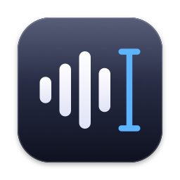
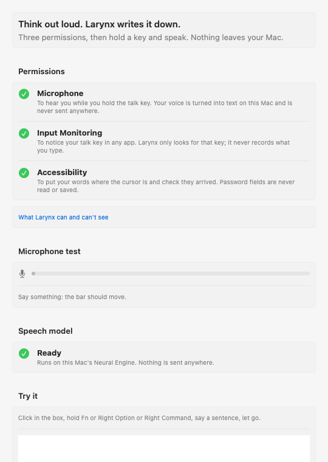
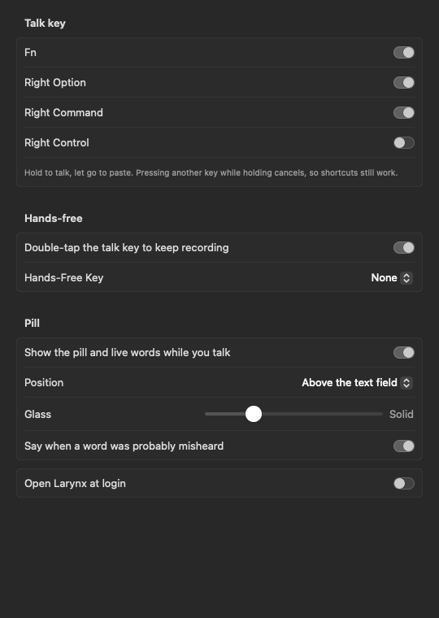
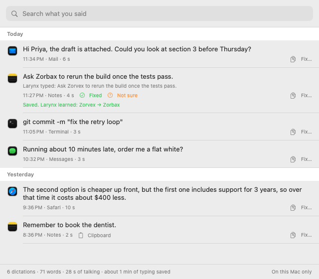

<h1> Larynx</h1>

[](https://github.com/StopBanning/larynx/actions/workflows/portable.yml)
[](https://github.com/StopBanning/larynx/actions/workflows/macos.yml)


**Think out loud. Larynx writes it down.**

Free, open-source, fully offline dictation for the Mac. Talk the way you think, with the ums, restarts and changes
of mind, and get back what you meant. Hold a key, speak, let go: clean, punctuated text lands
wherever your cursor is, in about 0.15 s. It works in every app, with no account, no subscription and no word
limits. Speech runs on your Mac's Neural Engine with NVIDIA's Parakeet models through
[FluidAudio](https://github.com/FluidInference/FluidAudio). Nothing you say ever leaves your Mac.

<p align="center"><b>0.15 s</b> from letting go of the key to text &nbsp;·&nbsp; <b>0 bytes</b> of your voice sent anywhere &nbsp;·&nbsp; <b>$0</b>, no limits</p>

<p align="center">
  
</p>
<p align="center"><sub>The pill: the app your words are going to, a waveform that moves with your voice, and the
words as you say them.</sub></p>

## Install

On an Apple Silicon Mac with macOS 15 or later, paste one line into Terminal:

```bash
curl -fsSL https://raw.githubusercontent.com/StopBanning/larynx/main/scripts/install.sh | zsh
```

It builds `~/Applications/Larynx.app` from source and opens it (a few minutes the first time). Apple's free
command-line developer tools are needed; the script opens their installer if they are missing. A setup window then
walks you through the three permissions (Microphone, Input Monitoring, Accessibility), a microphone test and a box
to try a dictation in. The speech model (about 600 MB) downloads once, on first launch, with a progress bar and the time left. Run the same line again to
update.

Then hold **Fn**, **Right Option** or **Right Command**, speak, and let go. Everything else is in the menu bar icon
and in Settings… (⌘,).

<p align="center">
  
  
</p>

<p align="center">
  
</p>

There is no downloadable app yet: a signed, notarized build needs a paid Apple developer account. Building from
source is the supported install for now.

**Uninstall.** One line removes the app and everything it stored (history, recordings, your words, the speech
models, settings, its Privacy & Security entries). It lists what it will remove and asks first; add
`--keep-data` after `zsh -s --` to keep your history and words.

```bash
curl -fsSL https://raw.githubusercontent.com/StopBanning/larynx/main/scripts/uninstall.sh | zsh -s --
```

## What it does

**Talking**

- **Hold to talk** with Fn, Right Option or Right Command (or a macro-pad button that sends one). Pressing another
  key while holding cancels, so your shortcuts still work.
- **Hands-free**: double-tap the talk key and keep talking with nothing held; press again to finish, Esc to cancel.
  Or pick a Hands-Free Key: one press starts, the next finishes. Stops by itself after 30 minutes.
- **Live preview**: a small Liquid Glass pill sits just above the text box you are dictating into. It shows the
  target app's icon, a waveform and your words as you say them, never takes focus, warns you if the microphone
  hears nothing, and shows a lock in a password field. A slider sets how see-through it is.
- **English is the measured language.** The default model (Parakeet Ultra) also transcribes 24 other European
  languages with no switch to flip; those work but are not measured yet, and the cleanup rules are English.
- **Pick your microphone** in Settings; an unplugged one falls back to the system default.

**Never loses your words**

- **The first word**: the microphone stays warm for 30 s after a dictation, so the next press starts instantly and
  includes the 0.15 s before it.
- **The last word**: if you let go of the key mid-word, Larynx keeps listening until the word ends (at most 0.3 s).
- **The right app**: the target app is captured when you press the key. Switch apps mid-sentence and Larynx brings
  the original back before pasting.
- **A paste that can't silently fail**: where the text field can be read, Larynx checks that the words arrived. If
  they did not, it inserts them through Accessibility, then by typing, then leaves them on the clipboard and says
  so. When it can't tell, it keeps the words on the clipboard as well.
- **A crash**: each recording is written to disk before it is transcribed, so if Larynx quits mid-way the next
  launch finishes the job and lists it under Recent as "Recovered".
- **A silent model**: if the main speech model hears nothing in a clip that clearly has speech, the backup model
  tries.

**Cleanup**

- **Fillers, stutters and false starts** are removed ("I went to the, I drove" → "I drove"), and self-corrections
  are applied ("Tuesday, no Wednesday" → "Wednesday"). All on your Mac.
- **Numbers as digits** in every app: "five point five" → 5.5, "three percent" → 3%, "two hundred K" → 200K,
  "seven thirty tonight" → 7:30. Small numbers stay words ("two things") unless a unit or label makes them numbers
  ("step 2"). Rules, not an AI call, so it is instant.
- **Fits what is already in the field**: several dictations into one message get the right space and capital
  between them; one that continues a sentence starts lowercase.
- **Layout by voice**: "new line" and "new paragraph" make real line breaks. In Mail and Outlook, a greeting and a
  sign-off go on their own lines.
- **Code by voice**: "camel case user id" → `userId` (also snake, kebab, pascal and constant case), "main dot
  swift" → `main.swift`, and API, JSON, GitHub and about 70 developer names get their proper spelling.
- **Snippets**: say a cue on its own ("my calendar link") and Larynx types the saved text.
- **The app sets the tone**: a light touch for AI chats, terminals and editors; finished sentences for Mail, Slack,
  Messages and Notes.

**Your words**

- **Knows your vocabulary**: your dictionary, a `vocabulary.txt` you can edit, and project names from the folders
  you choose (`vocabularyRoots`, `~/work` by default). A small keyword model swaps a misheard word only when it
  sounds like one of your terms ("macropod" → "Macropad").
- **Teaches itself**, two ways, and the pill says "Learned" when it does. *Say it again*: repeat a sentence within
  90 seconds with one word changed and Larynx learns the fix. *Fix it in place*: for 20 seconds after a paste,
  Larynx watches the text field; change a word to one that sounds like what it heard and it learns that too. The
  menu has Undo Learned.
- **Two styles**: casual for friends and AI chats, professional for work. Professional drops "you know", "dude",
  swearing for emphasis and "gonna", and turns spoken lists into lists. Turn it on in the menu, or hold the
  Professional Key (set it in the menu) for one dictation.

  > Yeah, so we're gonna need the slides by Friday, you know?  →  We're going to need the slides by Friday.
- **Fix it once**: when a dictation came out wrong, open History (or Fix Last Dictation… in the menu), press Fix…
  and type what you said. An invented word ("Zorvex" for "Zorbax") is corrected from then on; two real words that
  sound alike are only noted, never swapped by themselves.
- **"Not sure about …"**: when the speech model was very unsure of a word, the pill names it for 2 seconds after
  the paste, so a glance catches it before you send. Your text is not changed.
- **"Scratch that"** said on its own within 30 seconds undoes the last dictation.

**Private by design**

- Audio and text never leave your Mac. There is no server, no account and no telemetry. A test runs speech to text
  with every network connection blocked and passes ([docs/PRIVACY.md](docs/PRIVACY.md)).
- **History stays local**: 30 days in a database on your Mac. The History window (menu: History…, ⌘Y) searches it,
  copies a dictation again and plays the recording when one is kept; `larynx history --search <words>` does the same
  from a terminal.
  Audio is not kept unless you turn on `keepAudio`. Nothing said into a password field or a password manager is
  ever stored. `history: off` keeps everything in memory only.

**For scripts and agents**

- Dictating into Claude Code, Cursor, ChatGPT or a terminal, and giving an agent Larynx as a tool with one line:
  [docs/AGENTS.md](docs/AGENTS.md).
- A CLI (`larynx transcribe note.m4a`), a JSON-lines API for host apps (`larynx serve`) and an MCP server
  (`larynx mcp`). See [docs/INTEGRATION.md](docs/INTEGRATION.md). Apps such as [Locust](https://locust.lol) embed
  it this way.

Every setting is listed in [docs/SETTINGS.md](docs/SETTINGS.md).

## Why Larynx

There are other good free, offline dictation apps for the Mac, and excellent paid cloud ones. What Larynx sets out
to do differently:

- **Text you don't have to fix.** Fillers, stutters, false starts and changes of mind are cleaned by rules,
  instantly, with no language model in the way: 0.87% of words wrong on real, randomly picked dictation
  ([docs/BENCHMARKS.md](docs/BENCHMARKS.md)).
- **It shows its work.** Privacy, speed, accuracy and the installer each have a test you can run
  ([Testing](#testing)), and the benchmarks include what was tried and lost.
- **It never loses what you said.** Every paste is checked, with three fallbacks and crash recovery.
- **Nothing held back.** MIT, no account, no paid tier, no limits.
- **Built for talking to AI all day.** Command line, JSON lines and an MCP server.

A measured comparison with the Mac's built-in dictation and other free apps is planned
([docs/PLAN-launch.md](docs/PLAN-launch.md), L0.5). Against cloud dictation in general:

| | Larynx | Typical cloud dictation app |
| --- | --- | --- |
| Where your audio goes | Stays on your Mac | Its servers |
| Works offline | Yes | No |
| Price, limits | Free, unlimited, MIT | Free tier with weekly limits, paid plans |
| Key-up to text | 0.14 s median over 285 real dictations (0.47 s at the 90th percentile; long dictations take longer) | Network round trip |
| Words wrong on real dictation | 0.87% over 57 of the author's dictations picked at random (references written from five engines, not yet by ear: [details](docs/BENCHMARKS.md)) | Not published |
| Cleanup | Fillers, stutters, false starts, self-corrections, numbers as digits, code by voice | Similar |
| Hands-free | Yes, up to 30 min | Yes |
| History | 30 days on your Mac, full-text search; password fields never kept | Yes |
| Learns your words | From repeats, from your edits and from fixes in the History window, with Undo | From your edits |
| Never loses a dictation | Checked paste with three fallbacks, crash recovery, target-app lock | Varies |
| Scriptable | CLI, JSON-lines API, MCP server | Limited |

Not there yet: a downloadable signed app, rewriting selected text by voice, measured support for languages other
than English, and Windows (the text engine and the speech model already run on Windows in CI:
[docs/WINDOWS.md](docs/WINDOWS.md)).

## Build from a checkout

```bash
git clone https://github.com/StopBanning/larynx && cd larynx
./scripts/make-app.sh                              # builds ~/Applications/Larynx.app
```

`make-app.sh` signs with your Apple Development identity if you have one (free with an Apple ID in Xcode), so
rebuilds keep their permissions and Apple's on-device model works. Without one it signs ad hoc, and each rebuild
makes macOS forget the permissions (`tccutil reset All com.automatedworkflow.larynx`, then allow them again).
The model lives in `~/Library/Application Support/Larynx/models`; the log is `~/Library/Logs/Larynx.log`. Some
keyboards (Keychron, for one) never send Fn to macOS: pick another talk key in Settings.

From a terminal:

```bash
swift build -c release
.build/release/larynx transcribe note.m4a          # print a transcript
.build/release/larynx listen --key fn              # system-wide hold-to-talk
.build/release/larynx history --search deploy      # search your dictation history
.build/release/larynx review                       # the last day in numbers: speed, deliveries, cleanup
.build/release/larynx serve                        # JSON lines for host apps
.build/release/larynx mcp                          # MCP server for agents
```

`listen` needs three macOS permissions, each granted by you in System Settings > Privacy & Security:
Microphone, Accessibility (to paste) and Input Monitoring (to see the key). The AI rewrite layer needs macOS 26.

## Cleanup

Four layers, cheapest first:

1. **Speech model.** The default, Parakeet Ultra (25 European languages), was picked by benchmark: about 37% fewer
   word errors than the previous default on jargon, noise and hard speech, and names spelled right twice as often
   ([docs/BENCHMARKS.md](docs/BENCHMARKS.md)). It types what you said, so the tidy rules remove the ums, repeats and
   false starts. `--engine clean` switches to Underdog Bark 3.0 Clean (English, non-commercial licence), which drops them as it listens.
2. **Tidy rules.** Leftover fillers, stutters ("the the", "I, I"), stranded commas and capitals. Instant, never
   rewrites a word, and leaves real doubles alone ("very very", "had had").
3. **Numbers.** Spoken numbers, times and percentages become digits by rule, in every app.
4. **AI rewrite, only when needed.** Self-corrections ("three, no wait, four") and verbal tics ("you know",
   "basically") go to Apple's on-device model (macOS 26+, free, about 0.3 s). It never runs for AI chats,
   terminals or code editors, and a guard rejects any reply that adds a word or drops too much, falling back to
   the tidied text. Turn it off in Settings (Cleanup) or with `--rewrite off`.

The app you are dictating into sets the mode: a light touch for AI chats, terminals and editors; text that ends like
a sentence for Mail, Slack, Messages and Notes.

## Testing

| Suite | What it checks | Latest |
| --- | --- | --- |
| `swift test` | 66 tests: every cleanup rule against `tests/cases.json`, 100 sentences that must not change in 3 modes, numbers, fitting the field, the rewrite guard, the pipeline, settings (each one documented), history, crash spool, privacy rules, self-learning, word confidence | all pass (Nov 12) |
| `python3 tests/suite.py --rewrite auto` | About 40 messy sentences spoken by 5 macOS voices at 2 speeds, transcribed and scored, plus a 26-case benchmark for the on-device AI rewrite | Nov 11: rules 73/73, rewrite 26/26, spoken 281/300 with Parakeet Ultra (most misses are the speech model mishearing a synthetic voice) |
| `python3 tests/protocol.py` | The `serve` and MCP wire formats stay compatible | pass |
| `python3 tests/agents.py` | The examples in [docs/AGENTS.md](docs/AGENTS.md): AI mode, the four MCP tools, the professional style, and your real dictionary untouched | 9/9 (Nov 13) |
| `scripts/when-idle.sh python3 tests/live.py` | A recording goes through the real listen and paste path into Larynx's own capture window only (never another app), once you're idle and the screen is unlocked; your clipboard and history are left as they were | 4/4 (Nov 11): verified paste 238 ms; dropped paste inserted once by the fallback; space after a finished sentence; space and lowercase mid-sentence |
| `python3 bench/latency.py` | The speed gate, run before each release: 50 clips through the full pipeline; fails over 150 ms median or 350 ms at the 90th percentile | 80 ms median, 144 ms p90 (Nov 12) |
| `python3 tests/history.py` | Kills a dictation mid-transcription; the next launch must recover it word for word | pass |
| `scripts/when-idle.sh python3 tests/privacy.py --prove` | Speech to text three ways inside a sandbox that denies every network connection; then a deliberate web request under the same sandbox, which must fail | 4/4 (Nov 12) |
| `python3 tests/metrics.py` | The launch metrics script (`scripts/metrics.py`, GitHub's own counts, no telemetry): counts add up and a day is never counted twice. Offline | 7/7 (Nov 13) |
| `python3 tests/install.py` | The installer into an empty home folder, signed ad hoc as on someone else's Mac: the bundle, its signature, icon and resources, the binary runs, no data left behind; then the uninstall leaves that home clean. Also runs in CI on a clean Mac | 11/11 (Nov 13) |
| CI `portable.yml` | The text engine builds and passes its tests on Windows and Linux; Parakeet runs on a Windows CPU | pass |

Spoken-suite detail (Parakeet Ultra, AI rewrite on where it would run, Nov 11):

| Area | Pass |
| --- | --- |
| Fillers | 75/80 |
| Repeats | 55/60 |
| False starts | 10/10 (harder ones: 10/20) |
| Self-corrections | 29/40 (0/40 without the rewrite layer; Bark Clean scored 38/40) |
| Trailing off | 8/10 |
| Verbal tics | 30/30 |
| Must not change | 111/120 |
| Real-world messages | 30/30 |

Nearly every remaining miss is the speech model mishearing a synthetic voice (hummus as "Hamas", Priya as "prio",
"uh-huh" as "aha"). Still open: dropping a spoken preamble ("The thing is, what I mean is, ...") is left alone on
purpose. NeMo inverse text normalization was tried for numbers and rejected: it turned "two thirty and it costs"
into "32 it costs".

## How it works

Three Swift targets: `LarynxText` (the text rules, Foundation only, builds on Windows and Linux), `LarynxCore`
(audio, the speech and language models, Accessibility) and `larynx` (the CLI and the menu bar app).

| File | Job |
| --- | --- |
| `Recorder.swift` | The microphone: 16 kHz mono, kept warm between dictations, with a short pre-roll and a tail |
| `Transcriber.swift` | Loads the speech model once, transcribes a clip, reports each word's confidence |
| `Hotkey.swift` | Event tap on one modifier; re-arms itself when macOS switches it off |
| `Inserter.swift` | Paste into the target app, check it arrived, fall back to Accessibility, typing, then the clipboard |
| `Pipeline.swift` | Runs the stages in order (snippet, dictionary, vocabulary, tidy, numbers, rewrite); each can be off, shadow or on |
| `Tidy.swift` | Cleanup rules and the per-app mode |
| `Numbers.swift` | Spoken numbers, times, percentages and units as digits |
| `Fit.swift` | Space and capital to match the text before the cursor |
| `Cleaner.swift`, `RewriteGuard.swift` | Optional Apple Foundation Models pass, and the guard that rejects a reply that adds words |
| `CodeWords.swift`, `Snippets.swift` | Spoken code and voice shortcuts |
| `Vocabulary.swift`, `Learner.swift` | Your words, and learning new ones from your fixes |
| `Doubt.swift` | Which words the model was unsure of |
| `Context.swift`, `ContextWords.swift` | Names in the text field you are dictating into, to settle sound-alike words (shadow) |
| `History.swift`, `Privacy.swift` | Local history (SQLite, full-text search), the crash spool, and what is never stored |
| `Golden.swift` | Your own recordings with what you meant, as a private benchmark |
| `HistoryFix.swift` | A fix made in the History window: saved, and turned into a lesson when it is safe to learn |
| `Pill.swift`, `Menu.swift`, `SettingsWindow.swift`, `HistoryWindow.swift`, `FirstRun.swift` | The pill, the menu bar menu, Settings, History and the setup window |
| `App/` | The listen session, the engine, `serve`, and the CLI commands |
| `MCP.swift` | The `mcp` command |

New cleanup rules start in **shadow**: they run on every dictation and record what they would have changed, without
touching the text. A rule is switched on only after its proposals have been read (`larynx mine --shadow`).

## How it was built

One person directing Claude. The plan was written first, as tasks with acceptance tests
([docs/PLAN-v1.md](docs/PLAN-v1.md), with a status table that records the evidence for each task); the code was
then written against it, and every cleanup rule was replayed over the author's own dictations before it shipped.
The record includes what was measured and rejected: a second speech model as a tie-breaker and a larger audio model
both lost to the default and were dropped ([docs/BENCHMARKS.md](docs/BENCHMARKS.md)). The author dictates
everything through Larynx, including the directions that built it.

## Roadmap

[ROADMAP.md](ROADMAP.md) is the short version; [docs/PLAN-v1.md](docs/PLAN-v1.md) is the road to 1.0, in order, and
[docs/PLAN-launch.md](docs/PLAN-launch.md) is how it gets to more people. To help, see [CONTRIBUTING.md](CONTRIBUTING.md).

- **Done**: the Parakeet Ultra model and its cleanup rules (0.5), then "Trust" (0.6): shadow mode, the live test
  rig, word confidence, no clipped first or last word, checked paste, the speed gate, fitting the field, the
  Settings and setup windows, the one-line install.
- **Next**: screen context out of shadow, per-app profiles, editors for your dictionary and
  snippets, a signed download.
- **Later**: streaming while you speak, spoken punctuation and lists out of shadow, writing styles, editing
  selected text by voice, more languages, an open benchmark anyone can reproduce, then Windows
  ([docs/WINDOWS.md](docs/WINDOWS.md)).

## License

Larynx is MIT. The speech models are downloaded on first use and keep their own licences:

| Model | By | Licence |
| --- | --- | --- |
| Parakeet Ultra (default) | moondream, from NVIDIA's Parakeet v3 | CC BY 4.0 |
| Parakeet v3, Parakeet CTC 110M | NVIDIA | CC BY 4.0 |
| Parakeet Unified | NVIDIA | NVIDIA Open Model License |
| Bark Clean, Bark 3.0 (optional) | Conway Research | CC BY-NC 4.0, **non-commercial** |

FluidAudio, which runs them, is Apache 2.0; the word list is SCOWL. Every source, link and licence text is in
[packaging/CREDITS.md](packaging/CREDITS.md), which also travels inside the app with the licence texts.
