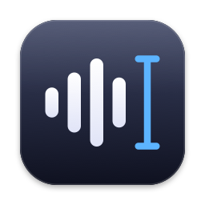
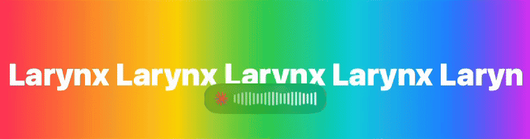
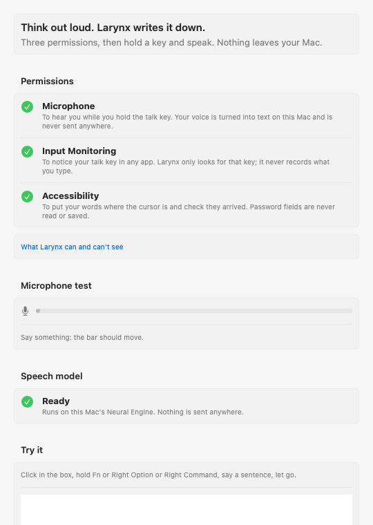
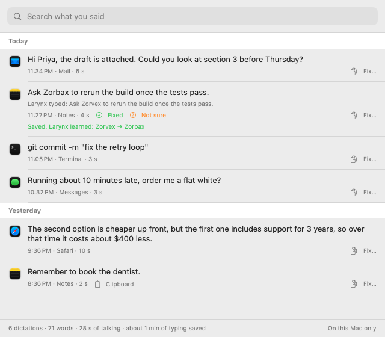

<h1> Larynx</h1>

[](https://github.com/StopBanning/larynx/actions/workflows/macos.yml)


**Think out loud. Larynx writes it down.**

Larynx is free, offline dictation for the Mac. Hold a key, talk the way you normally would, and let go. Clean,
punctuated text shows up wherever your cursor is, in any app. The ums, repeated words and false starts are taken out.

Speech recognition runs on your Mac's Neural Engine using NVIDIA's Parakeet models through
[FluidAudio](https://github.com/FluidInference/FluidAudio). Nothing you say leaves your Mac. There's no account,
no subscription and no word limit.

<p align="center"><b>0.15 s</b> from letting go of the key to text &nbsp;·&nbsp; <b>0 bytes</b> of your voice sent anywhere &nbsp;·&nbsp; <b>$0</b>, no limits</p>

<p align="center">
  
</p>

## Install

You need an Apple Silicon Mac with macOS 15 or later. Paste this into Terminal:

```bash
curl -fsSL https://raw.githubusercontent.com/StopBanning/larynx/main/scripts/install.sh | zsh
```

This builds Larynx from source into `~/Applications` and opens it. The first build takes a few minutes. If Apple's
free command-line developer tools aren't installed, the script opens their installer for you. They need to be
version 26 or newer (Swift 6.2); on older tools the script says so and how to update.

A setup window then walks you through three permissions (Microphone, Input Monitoring and Accessibility) and a
quick microphone test. The speech model (about 600 MB) downloads once, on first launch.

To update, run the same line again.

There's no downloadable app yet. A signed download needs a paid Apple developer account, so building from source is
the way to install for now.

<p align="center">
  
  
</p>

### Uninstall

This removes the app and everything it stored. It shows you the list and asks first. Add `--keep-data` at the end to
keep your history and words.

```bash
curl -fsSL https://raw.githubusercontent.com/StopBanning/larynx/main/scripts/uninstall.sh | zsh -s --
```

## Using it

Hold your talk key, talk, and let go. You pick it in the setup window: **Right Option** unless you choose **Right
Command** or **Fn**. Everything else is in the menu bar icon and in
Settings (⌘,).

- **Hands-free.** Double-tap the talk key and keep talking without holding anything. Press it again to finish, or Esc
  to cancel.
- **Live preview.** A small pill above the text box shows your words as you say them.
- **History.** The last 30 days of dictations, searchable, kept on your Mac (menu → History, ⌘Y).
- **Fix it once.** If a word comes out wrong, fix it in History and Larynx gets it right from then on. It also learns
  when you repeat a sentence with one word changed, or edit a word right after it's typed.
- **Your words.** Add names and jargon to your dictionary, or let Larynx pick up project names from your folders.
- **Two styles.** Casual for friends and AI chats, professional for work. Professional also drops "you know",
  "gonna" and the like.
- **"Scratch that"** on its own undoes the last dictation.

## What the cleanup does

| You say | Larynx types |
| --- | --- |
| Can you, um, send me the the slides by Tuesday, no, Wednesday? | Can you send me the slides by Wednesday? |
| I went to the, I drove to the store. | I drove to the store. |

- Takes out fillers, stutters, repeated words and false starts.
- Applies changes of mind: "Tuesday, no Wednesday" becomes "Wednesday".
- Turns spoken numbers into digits: "five point five" → 5.5, "three percent" → 3%, "seven thirty tonight" → 7:30.
- Turns "new line" and "new paragraph" into real line breaks, and lays out greetings and sign-offs in Mail.
- Spells code: "camel case user id" → `userId`, "main dot swift" → `main.swift`.
- Adjusts to the app. AI chats, terminals and code editors get a light touch. Mail, Slack and Messages get finished
  sentences.

All of this is rules, so it's instant. An optional pass by Apple's on-device model (macOS 26 and later) is off by
default: each run took about 2 seconds, and it rarely changed anything the rules don't. You can turn it on in
Settings; it never runs in AI chats, terminals or editors.

## Privacy

Your audio and text stay on your Mac. There's no server, no account and no telemetry. A test runs speech to text
with every network connection blocked, and it passes.

The one exception is meeting notes, which are optional. If you set up Claude or Gemini to write them, the
meeting's transcript text goes to that service. The audio never does. Details are in [docs/PRIVACY.md](docs/PRIVACY.md).

Nothing dictated into a password field or a password manager is ever stored.

## How it compares

There are other good free, offline dictation apps for the Mac. Here's what Larynx does differently:

- **Text you don't have to fix.** On 57 of my own dictations picked at random, 0.87% of words were wrong. That's
  scored against machine-made references, not yet checked by ear ([benchmarks](docs/BENCHMARKS.md)).
- **It's fast.** The median time from letting go of the key to text is 0.14 s, over 285 real dictations.
- **It never loses what you said.** Every paste is checked, with fallbacks, and a crash mid-dictation is
  recovered on the next launch.
- **It shows its work.** The speed, accuracy, privacy and installer claims each have a test you can run
  ([docs/TESTING.md](docs/TESTING.md)).
- **It works with AI tools.** There's a command-line tool and an MCP server ([docs/AGENTS.md](docs/AGENTS.md)).

Not there yet: a signed download, editing selected text by voice, tested support for languages other than English,
and Windows (in progress, see [docs/WINDOWS.md](docs/WINDOWS.md)).

## For developers

```bash
git clone https://github.com/StopBanning/larynx && cd larynx
./scripts/make-app.sh                              # builds ~/Applications/Larynx.app
```

From a terminal:

```bash
swift build -c release
.build/release/larynx transcribe note.m4a          # print a transcript
.build/release/larynx history --search deploy      # search your dictation history
.build/release/larynx serve                        # JSON lines for apps
.build/release/larynx mcp                          # MCP server for agents
```

More reading:

- [docs/ARCHITECTURE.md](docs/ARCHITECTURE.md): how the code is laid out and how the cleanup works
- [docs/INTEGRATION.md](docs/INTEGRATION.md): the CLI, the JSON-lines API and the MCP server
- [docs/SETTINGS.md](docs/SETTINGS.md): every setting
- [docs/TESTING.md](docs/TESTING.md): every test suite and its latest result
- [docs/BENCHMARKS.md](docs/BENCHMARKS.md): what was measured, including what was tried and dropped
- [CONTRIBUTING.md](CONTRIBUTING.md) and [ROADMAP.md](ROADMAP.md)

Larynx was built by one person working with Claude Code. I dictate everything through it, including the work on
Larynx itself.

## License

Larynx is MIT. The speech models download on first use and keep their own licenses:

| Model | By | License |
| --- | --- | --- |
| Parakeet Ultra (default) | moondream, from NVIDIA's Parakeet v3 | CC BY 4.0 |
| Parakeet v3, Parakeet CTC 110M | NVIDIA | CC BY 4.0 |
| Parakeet Unified | NVIDIA | NVIDIA Open Model License |
| Bark Clean, Bark 3.0 (optional) | Conway Research | CC BY-NC 4.0, **non-commercial** |

FluidAudio, which runs them, is Apache 2.0. Every source and license text is in
[packaging/CREDITS.md](packaging/CREDITS.md).
